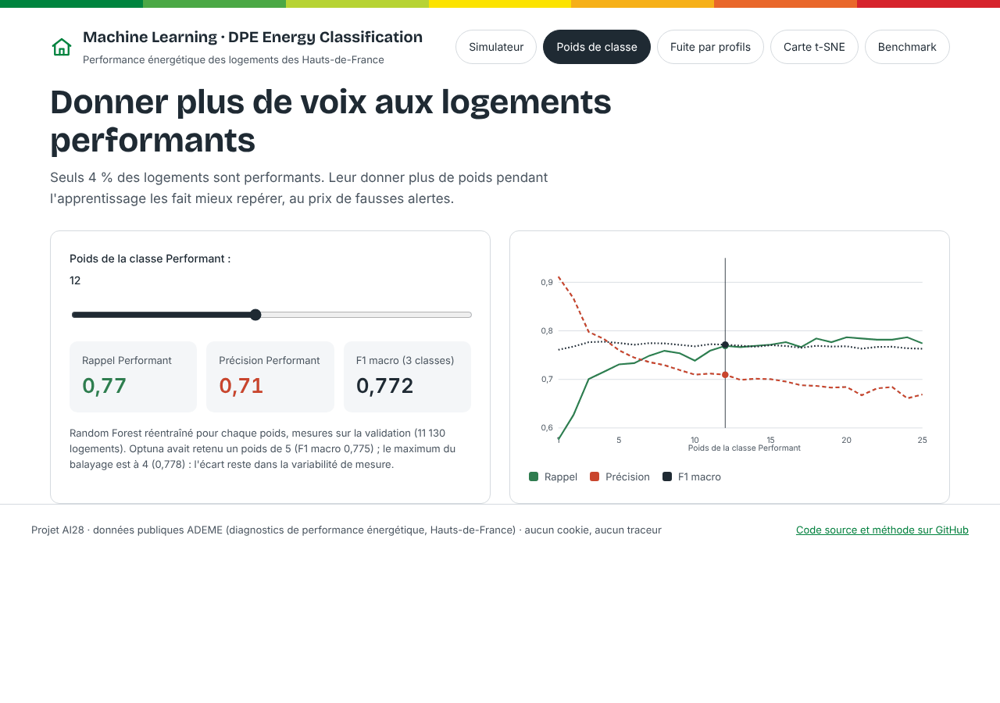
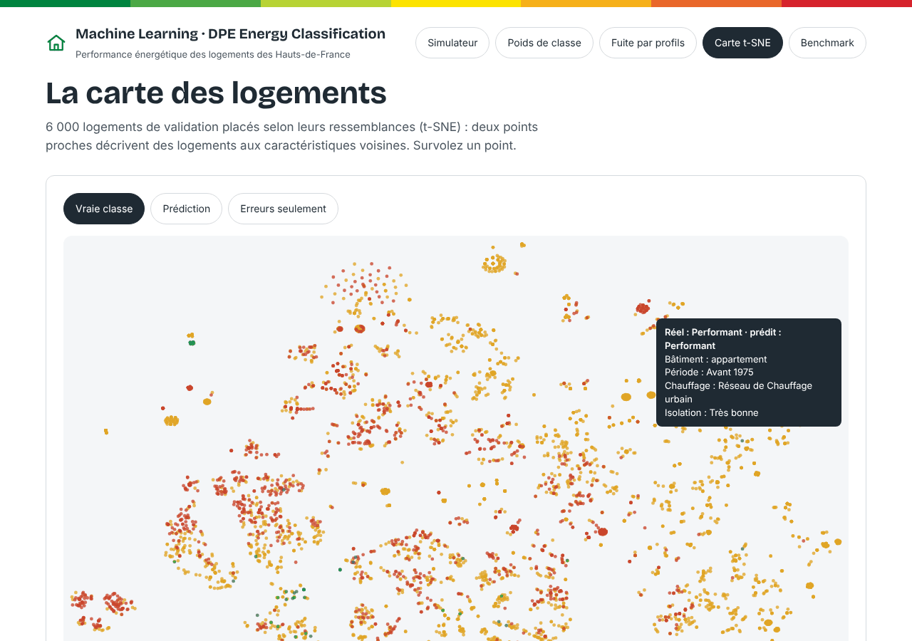
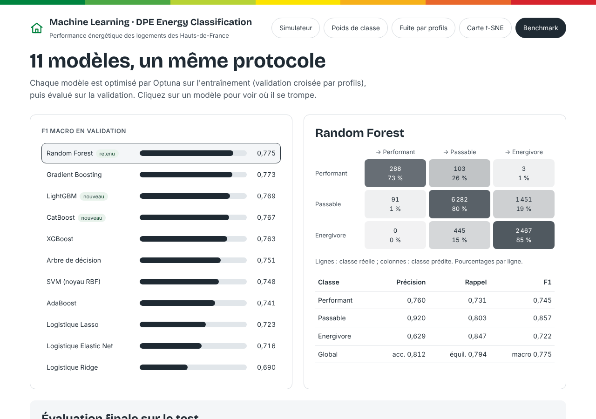

# Machine Learning · DPE Energy Classification

[](https://github.com/berullekkb/dpe-energy-classification/actions/workflows/pages.yml)

**Site interactif : [berullekkb.github.io/dpe-energy-classification](https://berullekkb.github.io/dpe-energy-classification/)**
(simulateur, poids de classe, fuite par profils, carte t-SNE, benchmark).

<table>
  <tr>
    <td width="50%"><a href="https://berullekkb.github.io/dpe-energy-classification/#simulateur"></a></td>
    <td width="50%"><a href="https://berullekkb.github.io/dpe-energy-classification/#fuite"></a></td>
  </tr>
  <tr>
    <td><b>Simulateur</b> : on part d'un logement réel, on modifie ses caractéristiques, le modèle (exécuté dans le navigateur) estime sa famille énergétique.</td>
    <td><b>Fuite par profils</b> : 45 % des logements ont un « jumeau » exact ; un découpage ligne à ligne gonfle le score (0,788 contre 0,763).</td>
  </tr>
  <tr>
    <td><a href="https://berullekkb.github.io/dpe-energy-classification/#poids"></a></td>
    <td><a href="https://berullekkb.github.io/dpe-energy-classification/#carte"></a></td>
  </tr>
  <tr>
    <td><b>Poids de classe</b> : le curseur montre le compromis rappel / précision de la classe Performant (Random Forest réentraîné pour chaque poids de 1 à 25).</td>
    <td><b>Carte t-SNE</b> : 6 000 logements de validation placés selon leurs ressemblances ; vraie classe, prédiction ou erreurs seules.</td>
  </tr>
  <tr>
    <td colspan="2"><a href="https://berullekkb.github.io/dpe-energy-classification/#benchmark"></a></td>
  </tr>
  <tr>
    <td colspan="2"><b>Benchmark</b> : les 11 modèles optimisés par Optuna sous le même protocole, avec la matrice de confusion de chacun en validation, puis l'évaluation finale unique sur le test.</td>
  </tr>
</table>

Projet AI28 : prédire la performance énergétique des logements des
Hauts-de-France à partir des données DPE de l'ADEME.

- **Cible** : `etiquette_dpe` regroupée en 3 classes : `Performant` (A-B),
  `Passable` (C-D) et `Energivore` (E-F-G).
- **Données** : 55 357 logements, 19 variables explicatives. Classes très
  déséquilibrées : 4,2 % / 71,5 % / 24,4 %.
- **Métrique principale** : F1 macro, accompagnée de la balanced accuracy, de
  la précision et du rappel par classe, et des matrices de confusion.

## Résultat principal

| | F1 macro | Balanced accuracy | Accuracy |
|---|---|---|---|
| Random Forest, validation (modèle retenu) | **0,775** | 0,794 | 0,812 |
| Random Forest, **test** (réentraîné sur train + validation) | **0,728** | 0,731 | 0,794 |
| Baseline initiale (logistique one-hot), test | 0,648 | 0,754 | 0,734 |

Sur le test, le Random Forest obtient pour chaque classe :

| Classe | Précision | Rappel | F1 |
|---|---|---|---|
| Performant | 0,76 | 0,55 | 0,64 |
| Passable | 0,91 | 0,79 | 0,84 |
| Energivore | 0,60 | 0,86 | 0,70 |

Lecture :
- La baisse entre la validation et le test vient surtout de la classe
  Performant : rappel de 0,73 en validation, 0,55 en test. Le test contient
  aussi plus de logements Performant (4,8 % contre 3,5 %).
- Sur 5 découpages aléatoires par profils, le même modèle obtient
  0,763 ± 0,019 (de 0,735 à 0,781). Le test est donc un découpage plutôt
  difficile.
- Les confusions extrêmes sont quasi inexistantes : 7 confusions Performant ↔
  Energivore sur 10 876 logements. Les erreurs passent presque toujours par la
  classe intermédiaire Passable.

## Protocole

1. **Séparation par profils** (`src/dpe/training.py`). 45 % des lignes
   partagent exactement leurs 19 variables avec une autre ligne. Chaque profil
   reçoit une empreinte SHA-256 et un profil reste entièrement dans un seul
   ensemble : Train 33 351, Validation 11 130, Test 10 876.
2. **Optimisation** (`src/dpe/optimization.py`). Optuna (TPE, graine 42,
   élagage médian), 25 essais par modèle, sur le **train uniquement**, avec
   `StratifiedGroupKFold(5)` par profils. Le prétraitement est ajusté dans
   chaque pli. Les espaces de recherche sont ceux des notebooks. Les poids de
   classe sont optimisés (Performant ∈ [1, 25], Energivore ∈ [1, 15]) et
   appliqués via `sample_weight`.
3. **Prétraitement historique** (`src/dpe/preprocessing.py`).
   `OrdinalTargetEncoder` reproduit exactement le `TargetEncoder` de
   category_encoders utilisé dans les notebooks (vérifié par un test).
   `RobustScaler` est appliqué aux 2 variables continues pour les modèles
   linéaires et le SVM.
4. **Sélection** : meilleur F1 macro sur la **validation**. La sélection est
   figée dans `results/metrics/selected_model.json` avant toute évaluation sur
   le test.
5. **Test** : un seul passage, avec le script `evaluate_final.py`. Il refuse
   de s'exécuter une seconde fois sans `--force`. Le test avait déjà servi à
   l'ancienne baseline, mais il n'a jamais servi à choisir un modèle ou un
   hyperparamètre.

## Benchmark sur la validation

| Modèle | Origine | F1 CV (train) | F1 macro val. | Balanced acc. val. | F1 Performant | F1 Passable | F1 Energivore |
|---|---|---|---|---|---|---|---|
| Random Forest | historique | 0,748 | **0,775** | 0,794 | 0,745 | 0,857 | 0,722 |
| Gradient Boosting | historique | 0,750 | 0,773 | 0,792 | 0,720 | 0,864 | 0,734 |
| LightGBM | nouveau | 0,755 | 0,769 | 0,783 | 0,711 | 0,884 | 0,712 |
| CatBoost | nouveau | 0,753 | 0,767 | 0,814 | 0,708 | 0,863 | 0,729 |
| XGBoost | historique | 0,744 | 0,763 | 0,812 | 0,743 | 0,835 | 0,713 |
| Arbre de décision | historique | 0,719 | 0,751 | 0,746 | 0,715 | 0,871 | 0,668 |
| SVM (noyau RBF) | historique | 0,704 | 0,748 | 0,742 | 0,703 | 0,871 | 0,669 |
| AdaBoost | historique | 0,720 | 0,741 | 0,769 | 0,696 | 0,854 | 0,673 |
| Logistique Lasso | historique | 0,697 | 0,723 | 0,727 | 0,659 | 0,869 | 0,642 |
| Logistique Elastic Net | historique | 0,701 | 0,716 | 0,760 | 0,644 | 0,831 | 0,673 |
| Logistique Ridge | historique | 0,706 | 0,690 | 0,667 | 0,556 | 0,837 | 0,675 |

Les cinq méthodes d'ensemble se tiennent en 0,012 de F1 macro. Écart entre
le Random Forest et le Gradient Boosting : 0,002. Ces écarts restent dans la
variabilité entre plis (écart-type de 0,015 à 0,02). Les modèles
d'ensemble dépassent nettement les modèles linéaires (environ +0,05).

Les paramètres optimaux de chaque modèle sont dans
`results/metrics/<modele>_best_params.json` et l'historique des essais dans
`<modele>_trials.csv`. Le tableau complet, avec précision et rappel par
classe, est dans `results/metrics/benchmark_validation.csv`.

## Notebooks historiques et différences de protocole

Les 8 notebooks de `notebooks/` ont été audités en détail : méthodes,
hyperparamètres, résultats, erreurs méthodologiques. Voir
[`docs/audit_notebooks.md`](docs/audit_notebooks.md). Points principaux :

- **Split stratifié ligne à ligne** dans les notebooks. Le rejeu contrôlé
  (`results/metrics/protocol_replay.csv`, sur train + validation, 5
  répétitions) montre que 43,5 % des lignes évaluées ont un profil déjà vu à
  l'entraînement. Sur ces lignes, les modèles d'arbres gagnent environ
  0,10 de F1 (mémorisation), ce qui gonfle leur score global de 0,02 à 0,03.
  Le Random Forest y retrouve exactement le score du notebook (0,788).
- **Sélection sur le test** dans les notebooks 03 à 07.
- **Rapports de classification mal étiquetés** : Performant et Energivore
  sont inversés.
- `log1p` appliqué deux fois au volume ECS.
- **Codes ordinaux** décalés par un problème d'accents. L'ordre de
  `classe_inertie_batiment_enc` est cassé (section 8 de l'audit).

Les scores historiques (`results/metrics/historical_vs_current.csv`) ne
sont donc pas comparables aux scores ci-dessus.

Les expériences historiques et les nouvelles sont distinguées par le champ
`origin` (`historical` / `new`). Nouvelles expériences : LightGBM, CatBoost
et l'ablation de l'encodage (`results/metrics/encoding_ablation.csv`).

## Nouvelle expérience : encodage des variables qualitatives

`scripts/encoding_ablation.py`, lancé après la sélection (il ne la modifie
pas), hyperparamètres fixés. F1 macro en validation :

| Modèle | Cible historique | Cible hors pli | One-hot |
|---|---|---|---|
| Random Forest | 0,775 | 0,774 | 0,778 |
| Gradient Boosting | 0,773 | 0,771 | 0,779 |
| LightGBM | 0,769 | 0,769 | 0,778 |
| Logistique Lasso | 0,723 | 0,723 | 0,743 |

L'encodage hors pli ne change rien : le lissage `min_samples_leaf=50`
suffit à limiter le biais. Le one-hot est légèrement meilleur partout, et
nettement pour le modèle linéaire (il évite d'imposer un score ordinal moyen
à chaque modalité). Piste d'amélioration : réoptimiser les modèles avec le
one-hot, en traitant ce choix comme un hyperparamètre sélectionné en
validation croisée.

## Fuites de cible

`scripts/audit_leakage.py` produit `results/metrics/leakage_audit.*` :
- aucune colonne ne correspond à une sortie du calcul DPE (consommation, GES,
  coût, etc.) ;
- la meilleure variable seule atteint un F1 macro de 0,48 ;
- les 19 variables sont des entrées du calcul réglementaire 3CL,
  légitimement disponibles avant le calcul de l'étiquette.

## Analyse des erreurs et visualisations

- `scripts/analyze_errors.py` : types d'erreurs, taux d'erreur par
  sous-groupe, confiance, erreurs communes à tous les modèles.
  - 5,4 % des logements de validation sont mal classés par les 11 modèles.
  - L'erreur principale du Random Forest est Passable → Energivore (69 % de
    ses erreurs).
- `scripts/visualize_projections.py` : ACP et t-SNE. L'encodage est ajusté
  sur le train et les points projetés viennent de la validation.
  - Dans l'espace des variables, 82 % des 10 plus proches voisins d'un
    logement Passable sont Passable, contre 60 % pour Performant et 63 % pour
    Energivore.

Figures dans `results/figures/` : comparaisons, F1 et rappel par classe,
matrices de confusion de chaque modèle, matrice de test, SVM (criblage des
noyaux, heatmap C × gamma, frontière ACP), ACP, t-SNE et zooms par paire de
classes.

## Site interactif

Le dossier `docs/` contient un site statique (HTML, CSS, JavaScript sans
dépendance, aucun cookie ni traceur). Il est publié sur GitHub Pages par le
workflow [`.github/workflows/pages.yml`](.github/workflows/pages.yml), à chaque
push sur `main` qui touche le site, ses tests ou `results/metrics/` :

1. **`verify`** : test de parité JavaScript / Python
   (`node tests/js/parity.test.mjs`) puis `pytest tests/test_site.py` ;
2. **`deploy`** : lancé seulement si `verify` réussit, il publie `docs/`.

Un site dont les chiffres ou les prédictions divergent du code Python n'est
donc jamais mis en ligne : la version précédente reste publiée.

- Toutes les données de `docs/data/` sont produites par
  `scripts/export_site_data.py` à partir de `results/` : aucun chiffre n'est
  saisi à la main. `tests/test_site.py` vérifie qu'elles correspondent aux
  résultats du dépôt.
- Le simulateur exécute le modèle LightGBM (F1 macro 0,769 en validation)
  directement dans le navigateur (`docs/assets/predict.js`). Le Random Forest
  retenu est trop volumineux pour un navigateur (209 Mo).
- `tests/js/parity.test.mjs` vérifie que le navigateur reproduit les
  probabilités Python sur 500 logements de validation (écart maximal
  5×10⁻¹³) et sur les 300 logements proposés par le simulateur.
- Le simulateur part toujours d'un logement réel de validation. L'inertie du
  bâtiment n'y est pas modifiable, car ses codes sont ambigus dans les
  données (section 8 de l'audit).
- Ces vérifications font aussi partie de `python -m pytest -q`, pour les
  lancer en local avant un push.
- Les captures d'écran du haut de ce README sont dans `docs/images/`.

Aperçu local :

```powershell
python -m http.server 8000 --directory docs    # puis http://localhost:8000
```

Mise à jour après de nouvelles expériences :

```powershell
python scripts/sweep_class_weights.py
python scripts/export_site_data.py
node tests/js/parity.test.mjs
```

## Structure

```text
src/dpe/
    config.py            chemins, cible, graine
    data_loader.py       lecture et validation des données
    preprocessing.py     encodages (one-hot, cible historique), pipelines
    training.py          séparation par profils, CV par groupes, sous-échantillon
    models/registry.py   11 modèles, espaces de recherche, poids de classe
    optimization.py      Optuna + StratifiedGroupKFold
    evaluation.py        métriques
    benchmarking.py      entraînement final, sauvegarde, tableau comparatif
    visualization.py     graphiques
scripts/
    check_split.py           contrôle de la séparation
    audit_leakage.py         audit des fuites
    train_logistic.py        baseline initiale (one-hot)
    tune_logistic.py         grille initiale sur C
    optimize_models.py       Optuna + validation, toutes familles
    train_svm.py             reprise complète du notebook SVM
    compare_models.py        benchmark, rejeu du protocole, sélection
    analyze_errors.py        analyse des erreurs (validation)
    visualize_projections.py ACP / t-SNE (validation)
    encoding_ablation.py     nouvelle expérience : encodages
    evaluate_final.py        évaluation unique sur le test
    sweep_class_weights.py   effet du poids de la classe Performant
    export_site_data.py      données du site
tests/                       65 tests pytest + test de parité JavaScript
results/metrics, results/figures   résultats versionnés
results/models                     modèles entraînés (non versionnés)
docs/                              site statique (GitHub Pages) et audit des notebooks
notebooks/                         notebooks historiques (inchangés)
```

## Reproduire les expériences

Prérequis : Python 3.11 ou plus récent, et le fichier
`data/processed/data_for_processing_final.xlsx` (non versionné).

```powershell
python -m venv .venv
.\.venv\Scripts\Activate.ps1
pip install -r requirements.txt
$env:PYTHONPATH = (Resolve-Path .\src).Path

python -m pytest -q                                   # 65 tests
python scripts/check_split.py
python scripts/audit_leakage.py
python scripts/train_svm.py --n-trials 25             # ~10 min
python scripts/optimize_models.py --family linear --n-trials 25    # ~45 min
python scripts/optimize_models.py --family tree --n-trials 25      # ~15 min
python scripts/optimize_models.py --family boosting --n-trials 25 --timeout 2700  # ~1 h 30
python scripts/compare_models.py                      # benchmark + sélection
python scripts/analyze_errors.py
python scripts/visualize_projections.py
python scripts/encoding_ablation.py
python scripts/evaluate_final.py                      # une seule fois
```

Vérification : relancer l'optimisation complète de l'arbre de décision
redonne exactement les mêmes paramètres, le même F1 en CV (0,71883) et le
même F1 en validation (0,75133).

Les durées sont indicatives, mesurées sur 2 cœurs. La graine est fixée
(`RANDOM_STATE = 42`) pour le découpage, Optuna, les sous-échantillons et
les modèles. Les résultats de `results/` ont été produits avec Python 3.13,
scikit-learn 1.9.1, pandas 3.0, Optuna 5.1, XGBoost 3.4, LightGBM 4.7 et
CatBoost 1.2.10. Avec d'autres versions, les scores peuvent varier
légèrement.

## Limites

- Les 908 profils aux étiquettes contradictoires (5 955 lignes) imposent une
  erreur irréductible avec ces 19 variables.
- Les regroupements de modalités du notebook 02 ont été construits sur
  toutes les données, cible comprise : légère fuite de conception, figée dans
  le fichier de données.
- Le budget d'optimisation est limité à 25 essais par modèle, et le
  Gradient Boosting a été plafonné à 45 minutes.
- Les probabilités ne sont pas calibrées.
